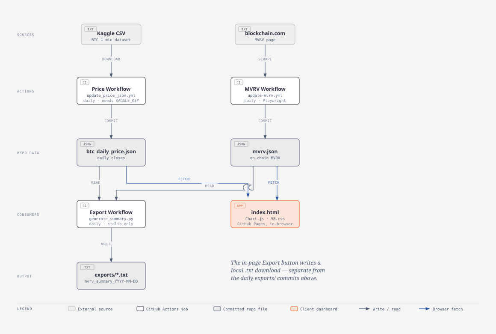

MVRV Analytics Dashboard
========================
https://0xtrvkc.github.io/dynamic-btc-analytics-dashboard/

Bitcoin on-chain cycle analysis. Entirely client-side.
No backend, no database, no login.

WHAT IT DOES
------------
Loads MVRV data + historical price data, then throws a bunch of
cycle analysis at you:

  - Z-score (rolling 365-day window, not all-time — avoids 2011 anchoring)
  - All halving cycles overlaid on one chart
  - MA20/50/200 with crossover events flagged
  - 30d and 90d rate-of-change momentum
  - Peak drawdown per cycle
  - Cycle extremes use one rule everywhere: the cycle TOP is the highest
    close within two years after the halving; the cycle BOTTOM is the lowest
    close after that top, up to the next halving (the bear-market low, not
    the post-halving dip). MVRV peaks/troughs use the same rule.
  - Bitcoin Spiral tab — every halving cycle as one clockwise turn
    (angle = estimated block position in the 210k-block cycle, radius =
    log10 price). Marks ATHs, cycle bottoms and halvings, compares every
    cycle at the same day-since-halving, hover for date/price/block,
    replay animation, SVG/PNG export, optional MVRV-zone coloring. Markers
    for price top/low (circles) and MVRV peak/low (diamonds); pick a cycle
    under "Focus" to isolate it and see the gap between each MVRV event and
    its price event. Needs btc_daily_price.json (+ mvrv.json for MVRV).
  - Cycle Timing tab — when tops and bottoms arrive (days since halving),
    MVRV peak/trough lead/lag vs price, entry/exit return heatmap by day
    since halving, calendar rules with a leave-one-cycle-out test, an MVRV
    entry/exit sensitivity grid, and a same-cycle-day comparison for the
    live cycle. Historical, descriptive, daily closes only — not advice.
  - Price scenarios from several simple models, fitted on completed cycles only:
      - Halving Multiplier  (pre-halving close × power-law cycle multiplier)
      - ATH Multiplier      (previous cycle top × power-law ratio of tops)
      - MVRV × Realized     (latest price ÷ MVRV × projected peak MVRV)
      - Floor versions of the same (halving floor ratio, bottom multiplier)
      - MVRV Upside / Downside — conditional scenarios that need a future
        turning point; shown separately, never in the ensemble or the backtest
    Ensemble = plain median of the eligible models, with the min–max spread.
    Nothing is trimmed (with 2–3 models an outlier test is meaningless).
  - Backtest tab — every model re-run as of the close of the UTC day BEFORE
    each halving, using only cycles completed before it (no lookahead).
    With today's data that is only one or two scored cycles, so every score
    shows its n and is an anecdote, not calibrated accuracy.

Export button spits out a .txt summary you can paste into an LLM
or just keep as a timestamped record.

FILES
-----
index.html                     The whole app. All logic lives here.
vendor/                        Self-hosted Chart.js 4.4.1 + chartjs-plugin-annotation 3.0.1
                               (byte-for-byte from npm; MIT licences included).
btc_daily_price.json           Daily BTC closes (UTC). Auto-updated by CI.
mvrv.json                      Daily MVRV. Auto-updated by CI (blockchain.com scrape).
btc_1h_price.json, btc_4h_price.json
                               Intraday closes. Not used by index.html yet; workflow is manual-only.
generate_daily_price_json.py   Price refresh script (called by Actions).
generate_intraday_price_json.py  1H/4H price files (manual workflow).
generate_summary.py            Headless Python port of the dashboard's analysis. Stdlib only.
scripts/update_mvrv.js         MVRV scrape + sanity checks (called by Actions).
scripts/push_with_retry.sh     Commit + rebase + push with retries (all workflows).
requirements-ci.txt            Pinned Python packages for the price workflows.
exports/                       Latest auto-exported summary (older days are in git history).

.github/workflows/  (all push through one concurrency group, so they never race)
  update_price_json.yml        Daily 00:17 UTC — Kaggle CSV → btc_daily_price.json.
  update-mvrv.yml              Daily 01:23 UTC — scrape, validate, update mvrv.json.
  auto_export_summary.yml      Daily 02:41 UTC — generate_summary.py → exports/.
  generate-intraday-price.yml  Manual only — 1H/4H price JSON.

HOW DATA GETS IN
----------------
MVRV data:
  The dashboard can load a JSON you manually export from blockchain.com,
  OR it auto-fetches mvrv.json straight from this repo (already there).
  The CI scrape keeps mvrv.json current daily so you don't have to touch it.
  The scrape reads the JSON blockchain.com's public chart page loads. It is not a
  documented API, so it can break, and you should check blockchain.com's terms.
  Before anything is committed, scripts/update_mvrv.js checks the new file: values
  between 0.05 and 20, strictly increasing dates, no more than 5% fewer points than
  before, and the same start date. A bad scrape fails the job and keeps the old file.

Price data:
  btc_daily_price.json is rebuilt daily from the Kaggle BTC 1-min dataset.
  Requires KAGGLE_USERNAME and KAGGLE_KEY in repo secrets.
  Without those secrets the price workflow will fail — everything else still works,
  you just lose the price overlay.

DATA FLOW
---------

  Kaggle + blockchain.com feed two daily workflows that commit JSON to the
  repo; a daily workflow reads that JSON to write exports/*.txt, and
  index.html fetches the same JSON straight in the browser (no backend).

  Note: the in-page Export button writes a local .txt download. That's separate
  from the exports/*.txt files committed by auto_export_summary.yml above.

AUTO-EXPORT
-----------
generate_summary.py runs once a day via GitHub Actions, after both data updates.
It reads mvrv.json + btc_daily_price.json and runs the same calculations as the
dashboard: rolling z, moving averages, cycle extremes, the price models and the
backtest. It writes exports/mvrv_summary_YYYY-MM-DD.txt.

Each run rewrites today's file and removes older ones from exports/. Every
previous day's export is still in the git history.
No secrets needed. Runtime is a few seconds. Set SKIP_CHAIN_CHECK=1 to skip the
block-explorer halving check when running offline.

If you change a calculation in index.html, change generate_summary.py too.

CONFIG
------
All the tunable knobs are at the top of index.html:

  ZSCORE_WINDOW: 365          rolling window for z-score (days)
  ZSCORE_CAPITULATION: -1.5   below this = capitulation signal
  ZSCORE_CAUTION: 1.0         above this = caution signal
  ROC_SHORT: 30               short momentum window (days)
  ROC_LONG: 90                long momentum window (days)
  AVG_CYCLE_DAYS: 1422        fallback interval only when no next estimate exists

The first four cycle starts are fixed to the UTC dates of blocks 210,000,
420,000, 630,000 and 840,000. Future dates shown in Cycle dates are estimates,
not new-cycle boundaries. On page load, the browser checks mempool.space and
Blockstream for the next 210,000-block boundary; both must report the same
hash and timestamp with six later blocks before the new cycle begins.
The scheduled Python export uses the same block rule independently. If the
explorers are unavailable, the last confirmed cycle remains active and the
next date remains an estimate. Browser-confirmed dates are saved locally;
the scheduled export checks the chain again on each run.

In Cycle Overlay, the return heatmap defaults to calendar months since each
confirmed halving; switch among 1, 2, 3, 4, 6, and 12-month windows. On desktop,
the compact 1–4 month grids fit the available width; on mobile they scroll horizontally.
Cells in those compact views omit the percent sign and round values to save space; hover or
select one for its precise return. Select any cell to inspect its exact UTC window, price
dates, daily path, running drawdown, volatility, MVRV change, data coverage,
and return relative to completed historical cycles. The unfinished live window
is labeled "so far" and compared at the same elapsed day in prior cycles.
Each cell shows the return within its window, rather than the cumulative gain
since halving. Future months appear as new daily prices arrive; if a halving
occurs later than month 48, the heatmap adds more columns. Historical ranks have only a
few prior cycles and are descriptive, not predictive.

STACK
-----
Vanilla JS. Chart.js 4.4 (self-hosted in vendor/).
Python 3.11 for the CI scripts (stdlib only — no pip install for generate_summary.py).
GitHub Actions for all automation.

No build step. No node_modules. index.html just works.

SECURITY NOTES
--------------
- Scripts load only from this site (vendor/), and a Content-Security-Policy
  limits network requests to jsDelivr, raw.githubusercontent.com, mempool.space
  and blockstream.info.
  To upgrade Chart.js: `npm pack chart.js@X` and copy dist/chart.umd.js to
  vendor/chart.umd.min.js. Do the same for the annotation plugin.
- Workflows pin actions to commit SHAs, pin Python/npm packages, declare
  `permissions: contents: write`, and never expose the Kaggle key while
  packages install.

NOT FINANCIAL ADVICE.
